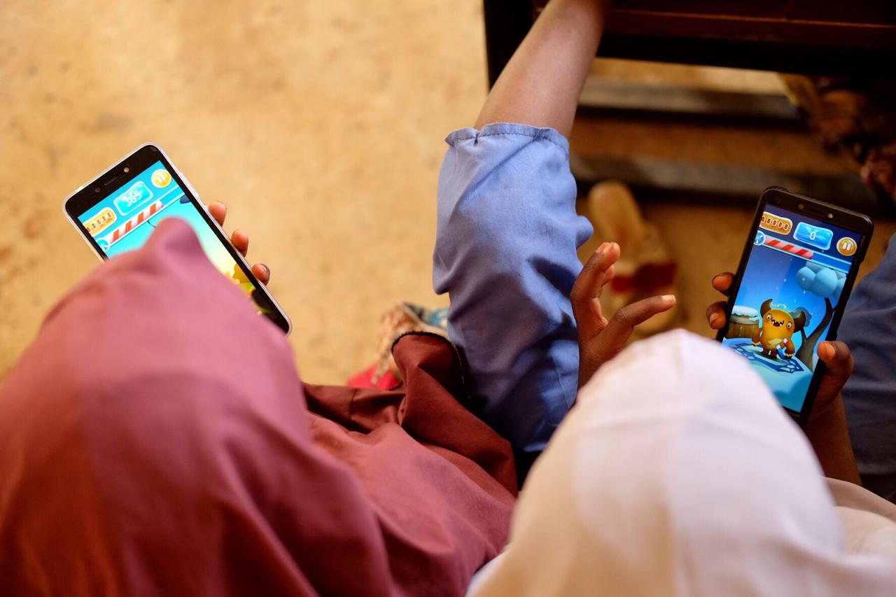
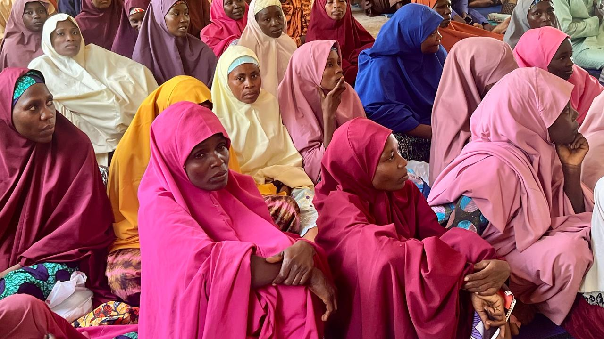
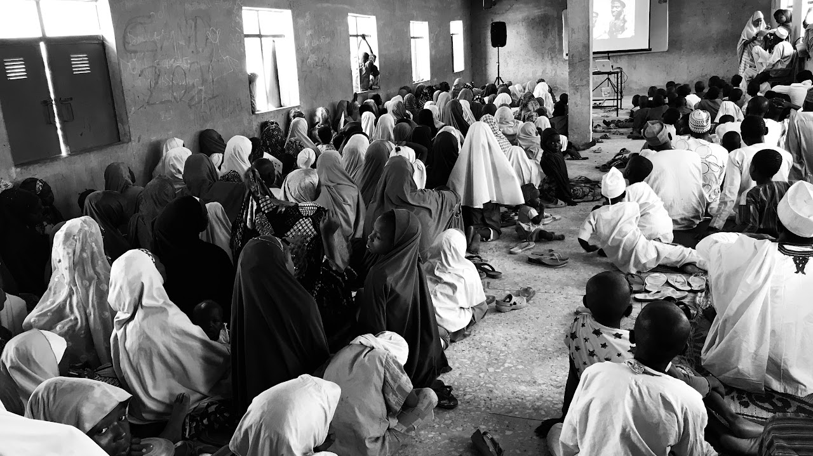
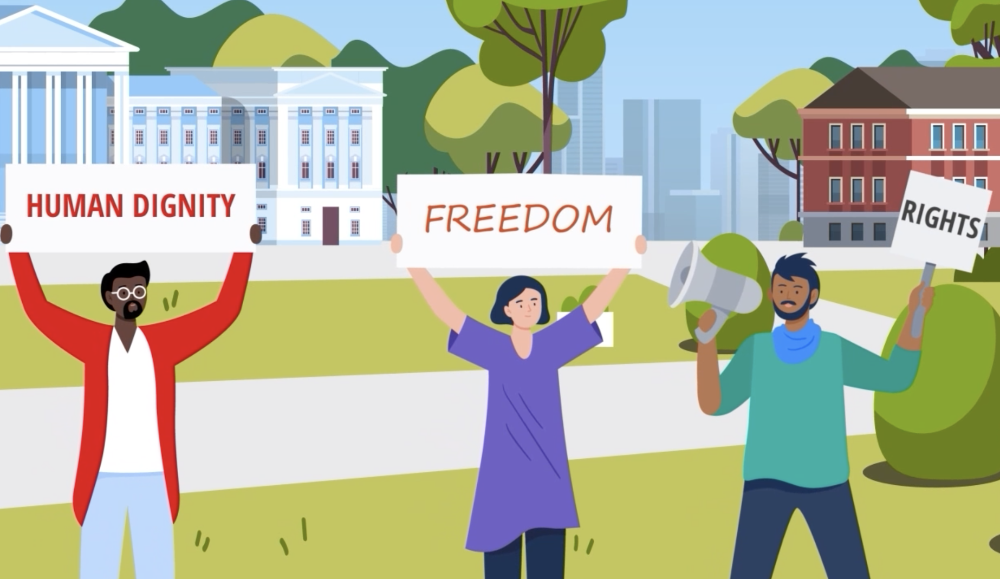
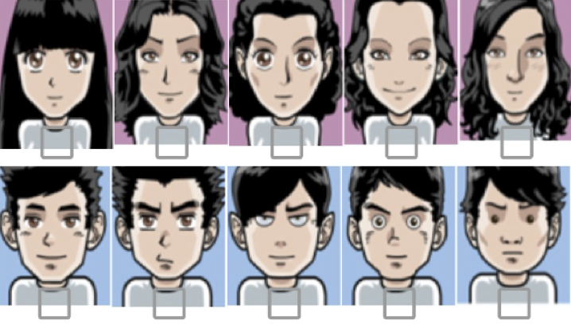
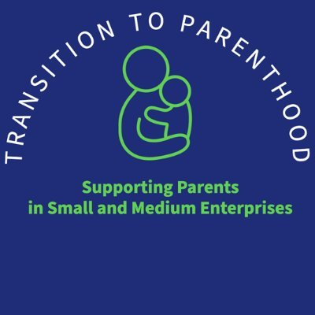
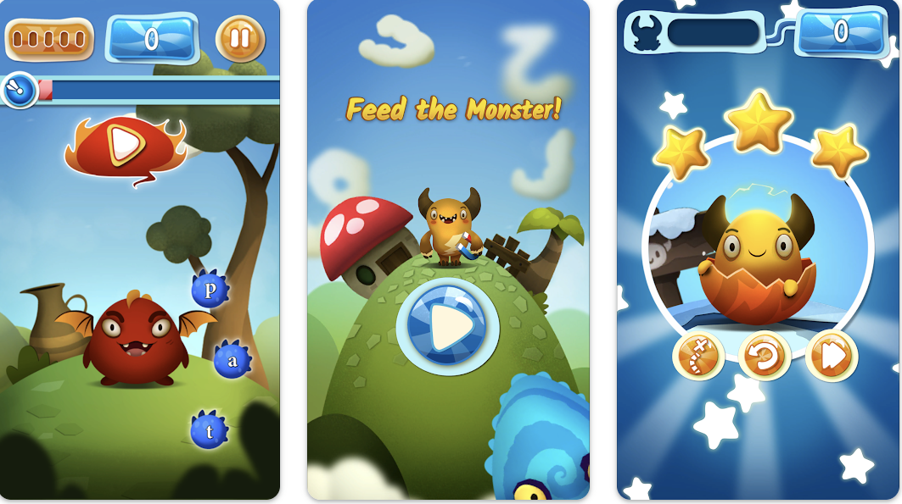
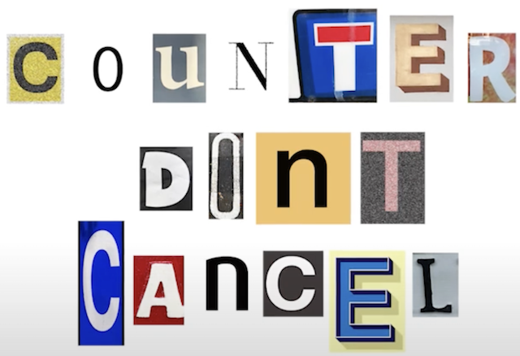
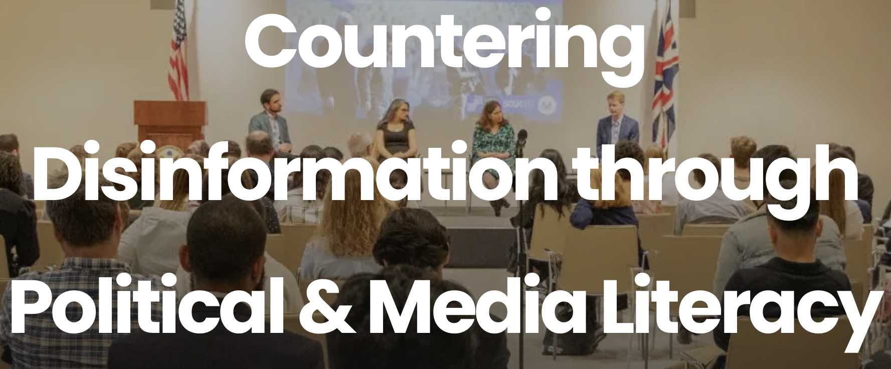

---
defaults:
  # _pages
  - scope:
      path: ""
      type: pages
      values:
layout: single
author_profile: true
permalink: /research/
title: Research
---
 
My research focuses on how parents influence child development and adolescent behaviour (schooling, learning and sexual outcomes), as well as how interventions could use behavioural insights to be more effective on the promotion of healthy habits and dissemination of information to facilitate labour market and school-related choices.  
 
My most recent research projects in the field focus on how to increase schooling enrolment and learning outcomes as well as to decrease early parenthood in rural communities in developing countries.
 
I am also working with political scientists to design interventions to promote democratic behaviour, as well as with government agencies and international organisations to promote mobile learning and mobile banking.   
 
My experience on design, implementation, and evaluation of social interventions in the field and on online platforms has been primarily in Africa and Middle East.  I primarily use randomised control trials (RCTs) to evaluate these interventions.

| | Project | Type | Country
 | Diffusing EdTech through Teacher and Household Networks | Cluster-randomised field trial | Nigeria
 | [Fostering human capital and youth empowerment in Northwest Nigeria](https://www.socialscienceregistry.org/trials/16233) | Cluster-randomised field trial | Nigeria
 | [Increasing school enrolment and learning through movies and mobiles](https://www.socialscienceregistry.org/trials/3619)  | Cluster-randomised field trial | Nigeria
 | [Sexual awareness through educational entertainment](https://aspredicted.org/e4h8c.pdf) | Randomised online trial | Ghana, Nigeria and Zambia
 | [Promotion of civic education in a new democracy](https://www.socialscienceregistry.org/trials/4509) | Randomised online trial | Tunisia
 | [Testing frames to learn about democracy](https://osf.io/qjrdz) | Randomised online trial | Worldwide
 | [Examining gender stereotypes and homophily in team formation](https://aspredicted.org/PZG_FHD) | Randomised online trial | UK 
 | [Transition to parenthood](https://x.com/T_to_Parenthood) | Survey experiment | UK
 | What Gets Parents to Install and Use a Reading App for Children? | Online experiment | Bangladesh, Nigeria, and Senegal
 | Raising awareness on misogyny and toxic masculinity | Research pilot | UK
 | [Prebunking for democracy](https://www.shoutoutuk.org)  | Research pilot | UK
